# Jio Has Placed a Dozen Bets Beyond the SIM. Here's the Scorecard.

### India's biggest IPO is pitched as a platform and priced like a telco. Ten years of Jio's product bets explain why, and what that predicts about AI.

*As of 23 October 2026, after subscription closed and before the 28 October listing.*

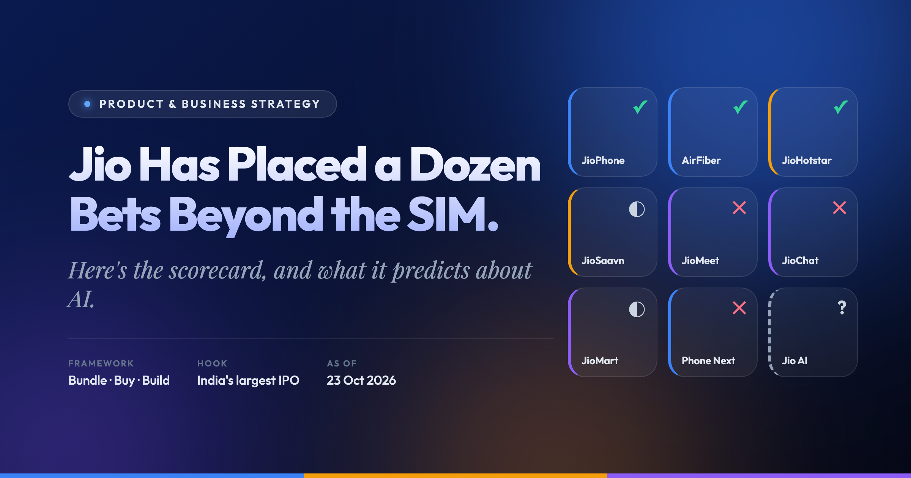

---

On 23 October 2026, subscription closed on the Jio Platforms IPO. About 1.38 crore applications came in, a record (Reuters) and, per ET Now and BusinessLine, the first IPO anywhere to cross one crore. The public book (excluding anchor investors) was covered about 22 times over, with institutions bidding for roughly 70 times the portion left after the anchor allotment. At the top of the price band, Jio is worth about ₹10.3 lakh crore, or around $107 billion. On 23 October the grey market was reportedly implying a listing premium of about 22% (unofficial, and not a forecast).

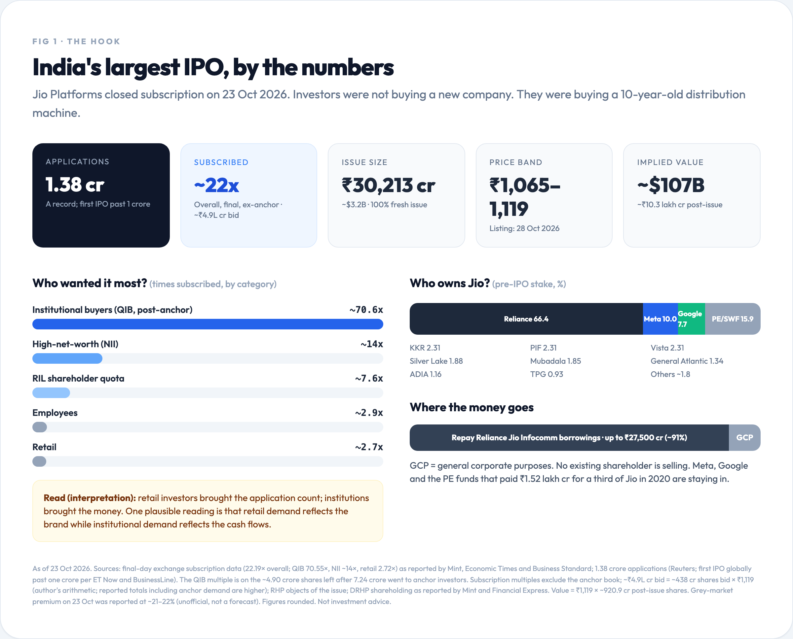

Most coverage will ask whether the listing pops. That is a question about one day. This piece asks a question about ten years:

**Every time Jio has tried to become more than a connection, what happened, and why?**

It matters because the IPO pitch leans on the word *platform*: the idea that Jio can launch products on top of its 500-million-plus connections and win commerce, entertainment, payments, cloud and now AI.

Jio has tested that claim many times, with messengers, browsers, video calls, music, streaming, phones and home broadband. Put the attempts side by side and the short answer to "telco or platform?" is this: **Jio is a distribution platform, and the market is pricing it as a telco.** The one-line version of the business model:

> **Jio sells distribution and buys preference.**

It wins when it can bundle. It buys the preference it can't build. And it has had far less success building standalone products that displace established specialists. The rest of this piece is the evidence.

---

## Act I: Building the distribution

In September 2016, Jio launched 4G with free data and free voice, and kept it free until March 2017. In about 170 days it had roughly 100 million subscribers.

Price mattered. According to TRAI, a gigabyte of wireless data in India cost about ₹269 in 2014. By 2018 it was about ₹11.78. Today Jio's realised revenue per GB, a different measure, is under ₹5.

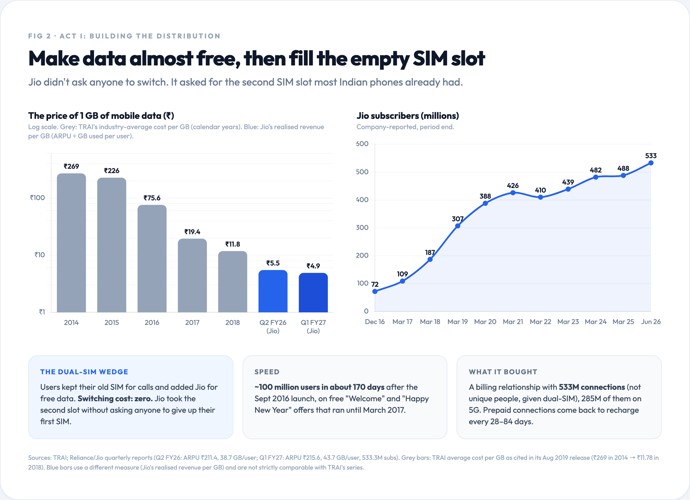

The less obvious reason is the **second SIM slot**. Most Indian phones in 2016 were dual-SIM, so Jio never had to ask anyone to *leave* Airtel or Vodafone. It only asked them to put a free SIM in the empty slot. Users kept their old number for calls. Switching cost was close to zero.

That is the first lesson, and it keeps returning: **Jio's best moves slot into a behaviour that already exists.**

(It is also why Jio's subscriber count is a count of *connections*, not people. Many users carry two SIMs.)

### The market Jio left behind

In 2016 India had around a dozen mobile operators. Within three years most were gone or merged: Telenor sold to Airtel, Reliance Communications shut its voice business, Aircel went bankrupt, and Vodafone and Idea merged to survive.

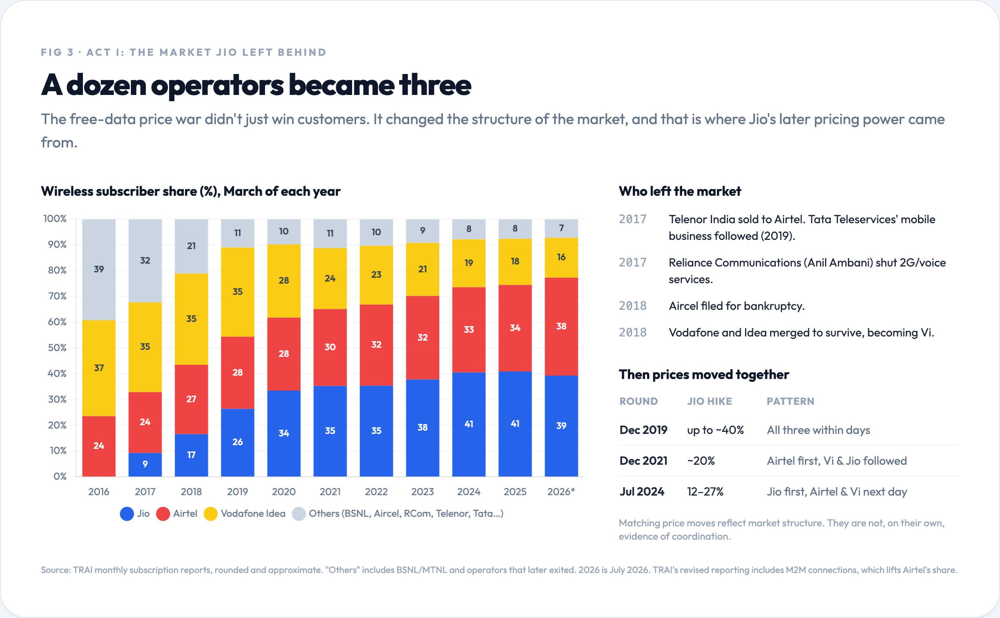

What was left was a three-player private market: Jio, Airtel and Vodafone Idea. Since 2019 there have been three major tariff rounds (December 2019, December 2021, July 2024), and each time all three moved within days. With twelve players, someone undercuts. With three, matching a rival's hike is the rational response. (Parallel moves like these don't imply coordination. Each operator can simply follow the others.)

**Jio's later pricing power didn't come mainly from a product. It came, at least partly, from the market structure its price war created.**

---

## Act II: The consolidation dividend

### Pricing power, and its limits

Jio's ARPU has risen from about ₹120 before the December 2019 hike to ₹215.6 in the June 2026 quarter.

The July 2024 hike is the clearest single test. Jio raised tariffs by 12–27%. In the following quarter it lost about **10.9 million subscribers** (around 2.2%), ARPU rose **7.4%**, and implied mobile revenue (subscribers × ARPU) rose roughly **5%**. It lost connections and still made more money.

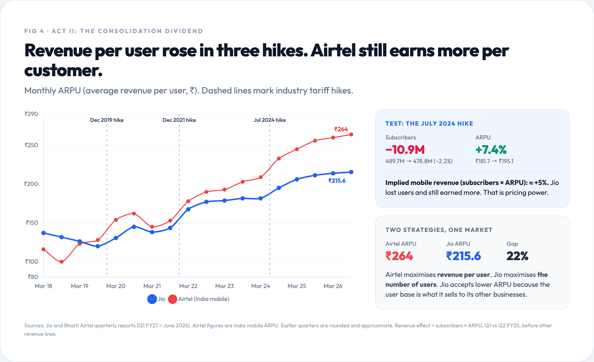

Two caveats keep this honest. That quarter mixes real churn with users dropping secondary SIMs, so it overstates how many *people* left. And the effect is fading: in Q1 FY27, ARPU grew only **3.3%** year on year (₹208.8 to ₹215.6), and net profit grew 9.2% against 15.1% EBITDA growth. Over the same period Airtel's ARPU grew about 5.6% (₹250 to ₹264). Pricing power is real, but it arrives in steps, at each hike, not as a steady climb.

Airtel's ARPU is ₹264, about 22% above Jio's. My read is that the gap reflects two emphases. Airtel's higher ARPU is consistent with extracting more **revenue per user** through postpaid, premium and enterprise. Jio's lower ARPU on a larger base is consistent with prioritising **the number of connections**, because the base is the asset it sells JioHotstar, JioMart, AirFiber and now AI into.

### The moat is a screen

About 90% of Indian wireless connections are prepaid (TRAI, March 2026). Prepaid plans expire, usually every 28, 56 or 84 days, so every recharge cycle creates a recurring purchase moment. Many of those recharges happen inside MyJio, though plenty also go through UPI apps and retailers.

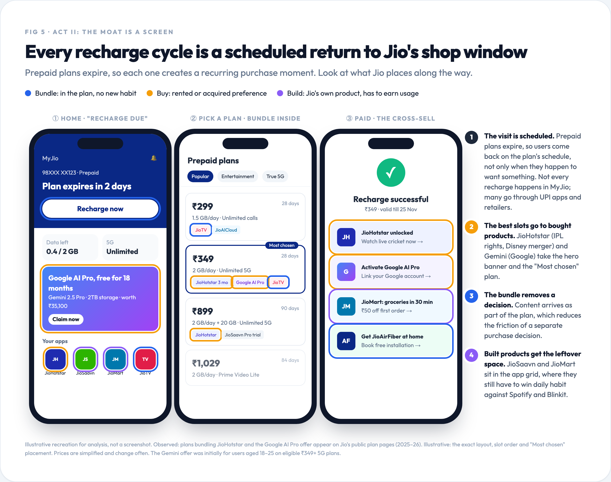

Look at what Jio does with that moment:

1. **The visit is scheduled.** Users come back on the plan's schedule, not only when they want something.
2. **The best slots go to products Jio bought.** JioHotstar and the Google AI Pro offer appear in the featured plans.
3. **The bundle removes a decision.** Content arrives as part of the plan, which reduces the friction of a separate purchase.
4. **Products Jio built get the leftover space.** JioSaavn and JioMart sit in the app grid, where they still have to win daily habit against Spotify and Blinkit.

(The plans themselves are public. The exact layout in Fig 5 is an illustrative recreation.)

**The recharge screen may be Jio's most valuable product.** It isn't sold to anyone. It's where everything else is sold. So what should Jio put on it?

---

## The framework: Bundle, Buy, or Build

Every attempt Jio has made to move beyond the connection fits one of three modes.

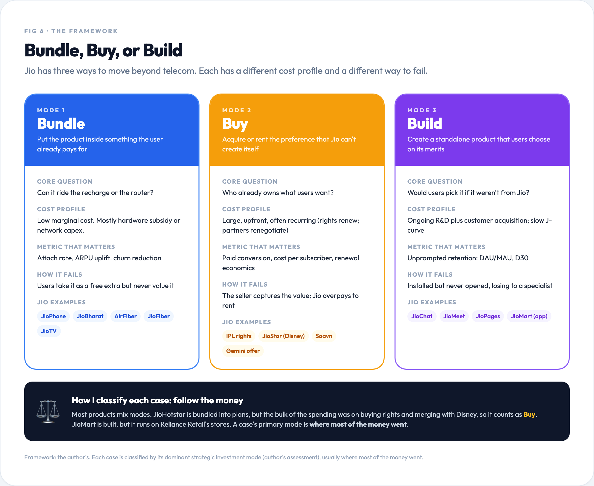

**Bundle.** Put the product inside something users already pay for. It fails when users accept the extra but never value it.

**Buy.** Acquire or rent preference that Jio can't create. Costs are large, upfront and often recurring. It fails when the seller captures the value.

**Build.** Create a standalone product people choose on its merits. Costs are ongoing engineering and acquisition. It fails when the app is installed but never opened.

Two questions are easy to blur here. **Mode** is how Jio entered a market, and I classify each case by its dominant strategic investment mode, which is my assessment (JioHotstar is bundled into plans, but its money went on cricket rights and the Disney merger, so it counts as Buy). **Success** depends on something else: whether the product removed a decision for users or asked them to make a new one. The scorecard below tracks both.

---

## The scorecard

I scored twelve of Jio's consumer bets over ten years on two axes:

- **Reuse (x):** how much it rides the existing Jio relationship (SIM, recharge, router, bill).
- **Preference (y):** how much it needs users to *choose* it over an alternative they already like.

Each axis has a written rubric, and each outcome has a stated "win if" criterion. Both are shown on the figures. The placements are my judgement, made with hindsight, so treat the map as a lens rather than a measurement. Evidence quality also varies: some bets have public adoption data, while others rest on launches, competitive position and indirect signals (each card carries an evidence rating).

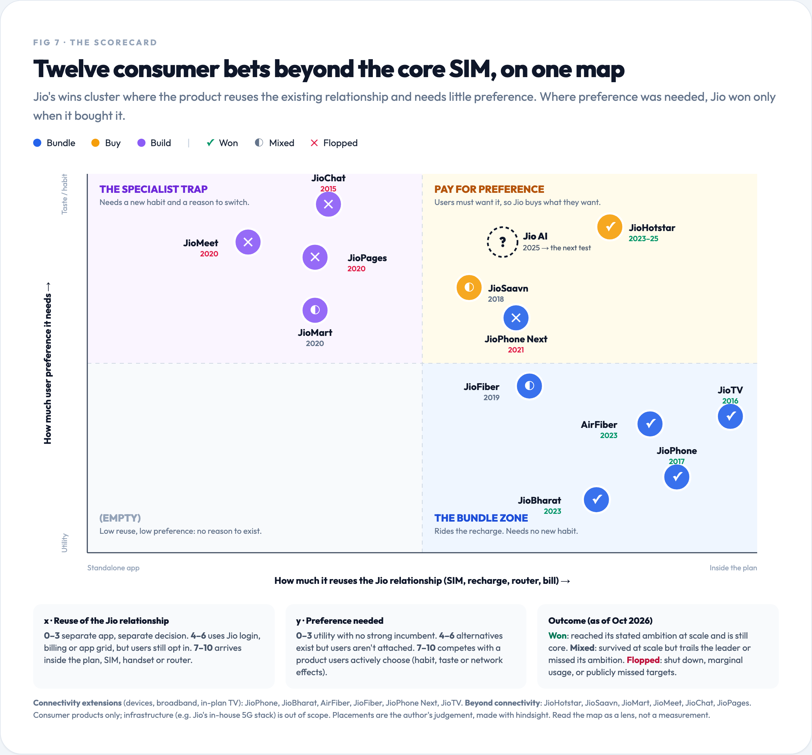

The map sorts itself. Bottom right, the **Bundle zone**, is where almost everything worked. Top left, the **specialist trap**, is where standalone apps that needed a new habit failed. Top right, **pay for preference**, is where Jio won only when it bought what users wanted. Bottom left is empty, sensibly.

The headline is 5 wins, 3 mixed and 4 flops. Those totals judge adoption and competitive position against the stated criteria. They don't measure financial return, which Jio doesn't disclose for most of these products. And the total hides the most important split.

### Part 1: Extending the connection

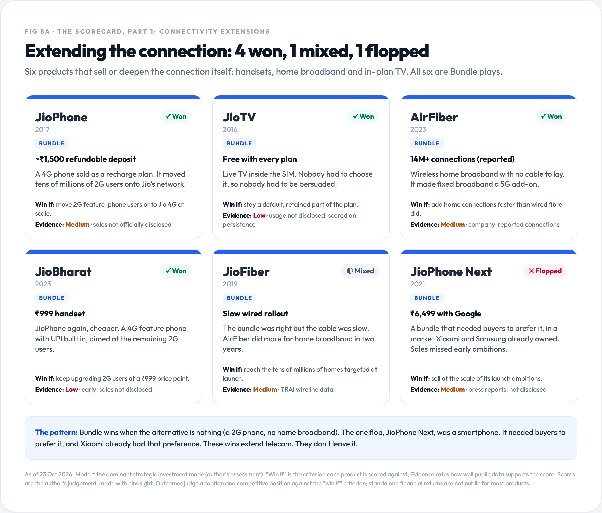

Six products deepen the connection itself: handsets, home broadband and in-plan TV. All six are Bundle plays. **4 won, 1 mixed, 1 flopped.** These wins are real, but they extend telecom rather than leave it.

### Part 2: Leaving the connection

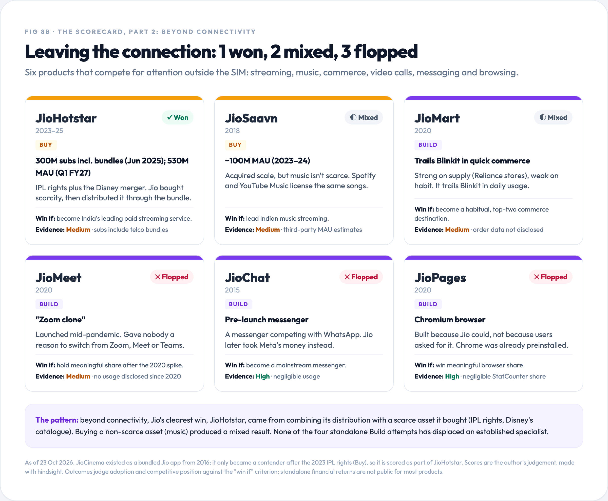

Six products compete for attention outside the SIM. **1 won, 2 mixed, 3 flopped.** The clearest win, JioHotstar, is the one where Jio bought the thing that made it win.

So the sharper version of the finding is this: **beyond connectivity, Jio's clearest win combined its distribution with a scarce asset it bought. Standalone apps have had a much harder time.**

### What the scorecard leaves out

This is a scorecard of *consumer products*. Jio's best Build is arguably infrastructure: the 4G network itself and the in-house 5G stack the RHP describes as part of a vertically integrated platform. Jio can clearly build hard things. What it hasn't done is build a consumer habit that displaces a specialist. That distinction matters for AI, where the infrastructure rung looks very different from the consumer-app rung.

### The timeline

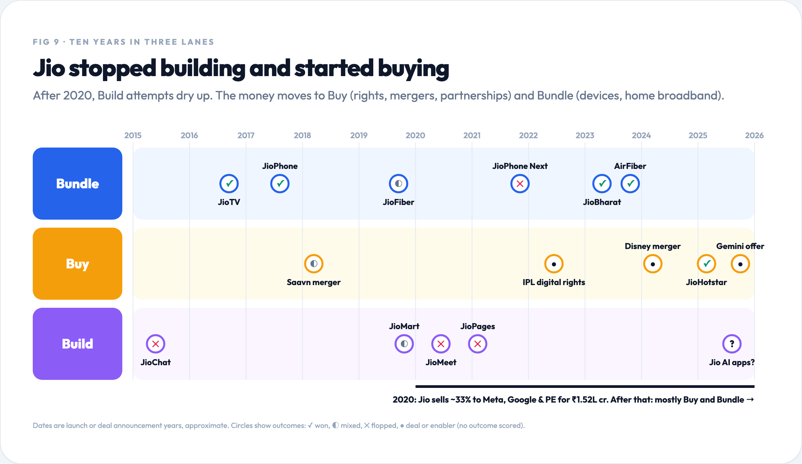

Before 2020, Jio tried all three modes. After 2020 it almost stopped building consumer apps. JioMeet and JioPages were the last serious attempts. Since then the money has gone into Buy (IPL rights, the Disney merger, the Gemini partnership) and Bundle (AirFiber, JioBharat).

2020 was the turning point. Jio sold about a third of itself to Meta, Google and a group of private equity and sovereign funds for ₹1.52 lakh crore, and JioMart launched *inside WhatsApp*, the messenger JioChat had been built to rival. That looks like an organisation adjusting to its own scorecard.

---

## Three cases that explain the pattern

### Case 1: Two phones, two outcomes

JioPhone and JioPhone Next are the most revealing comparison in this story. Same company, same bundle strategy, opposite results. It isn't a controlled experiment (the market, the timing and the chip supply all changed), but the contrast is hard to ignore.

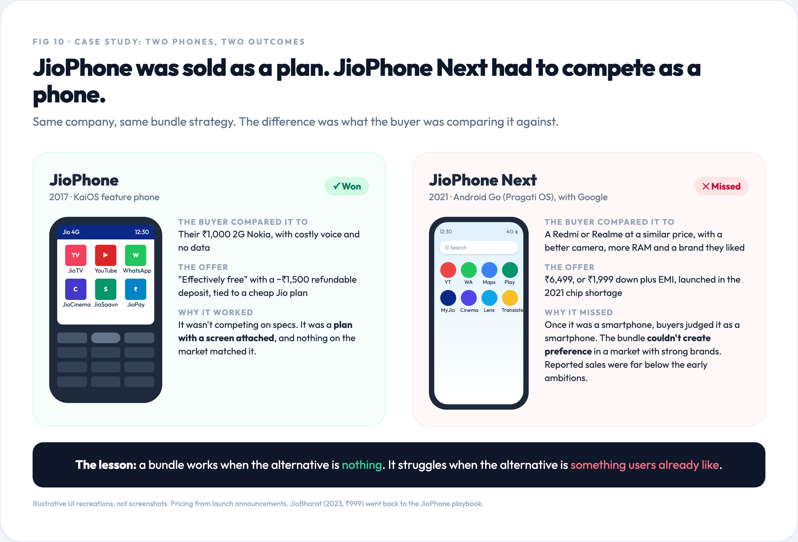

**JioPhone (2017)** was a 4G feature phone, "effectively free" with a refundable deposit of about ₹1,500 and tied to a cheap plan. The buyer was comparing it to a ₹1,000 2G Nokia with expensive calls and no data. It wasn't competing on specs. It was **a plan with a screen attached**.

**JioPhone Next (2021)** was an Android phone built with Google, at ₹6,499 or ₹1,999 down plus instalments, launched in a chip shortage. Now the buyer was comparing it to a Redmi or Realme with a better camera and a brand they already liked. Jio doesn't disclose sales, but third-party estimates suggest they fell well short of early ambitions.

> **A bundle works when the alternative is nothing. It struggles when the alternative is something users already like.**

JioBharat (2023, ₹999) went straight back to the original playbook.

### Case 2: JioMeet and the Build trap

In July 2020, at the peak of the pandemic, Jio launched JioMeet. It was widely called a Zoom clone, and it was.

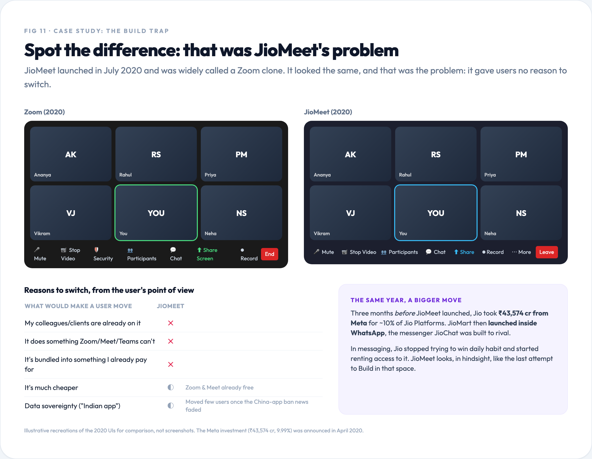

From the user's side: were colleagues already on it? No. Did it do anything Zoom, Meet or Teams couldn't? No. Was it bundled into something they paid for? No. Was it cheaper? Not really. Was "an Indian app" a reason to switch? Briefly, during the China-app ban, and then not.

JioMeet had distribution. It lacked a **reason to switch**. Distribution gets an app installed. Only preference gets it opened again tomorrow.

The same year, Jio made a bigger move. Three months *before* JioMeet launched, it had taken ₹43,574 crore from Meta for about 10% of the company, and JioMart then launched inside WhatsApp. In messaging, Jio stopped trying to win daily habit and started renting access to it.

### Case 3: JioHotstar, the Buy that worked

Jio couldn't build cricket fandom, so it bought the IPL.

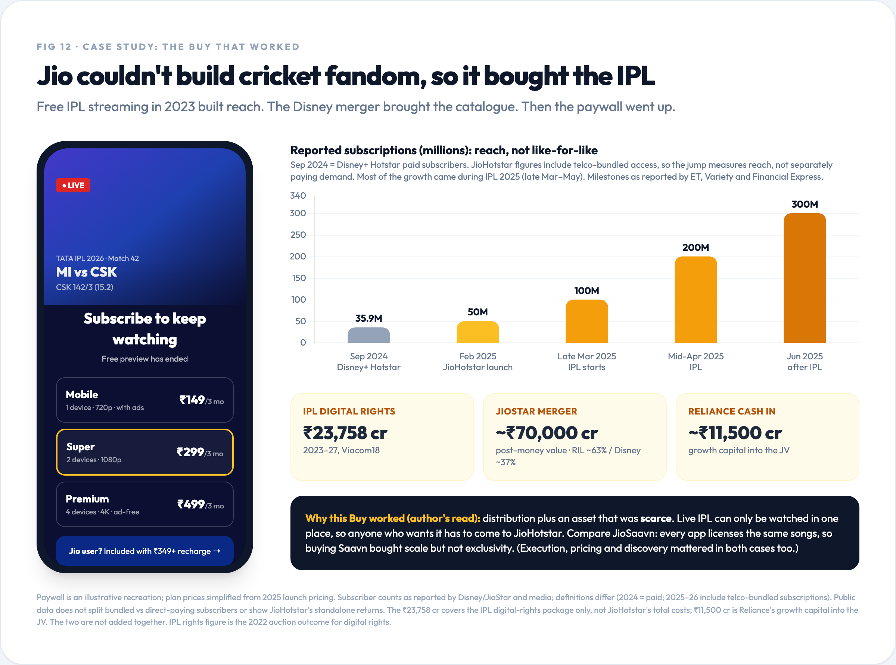

1. **Buy the rights.** Viacom18 paid ₹23,758 crore for IPL digital rights for 2023–27.
2. **Give it away to build reach.** IPL 2023 streamed free on JioCinema.
3. **Buy the catalogue.** Reliance merged its media business with Disney Star into JioStar, adding roughly ₹11,500 crore of growth capital.
4. **Put up the paywall**, and bundle it into recharges.

Disney+ Hotstar had about 36 million paid subscribers in 2024. JioHotstar launched in February 2025 with about 50 million, crossed 100 million in late March as IPL 2025 began, 200 million by mid-April, and 300 million by June. (By Q1 FY27, during IPL 2026, JioStar reported 530 million average monthly active users, a usage measure rather than subscriptions.) Those figures include telco-bundled plans, so they aren't like-for-like with the 2024 number. The jump measures reach, not paying intent. But the timing is telling: most of it arrived during the IPL, the scarce asset. That is still the point: the bundle distributes the thing Jio bought. How much of that reach turns into revenue isn't disclosed.

The two cheques are also different things. ₹23,758 crore bought the IPL digital rights for five seasons. The ₹11,500 crore was growth capital for JioStar. Neither is the full cost of the business, and they shouldn't be added together.

JioCinema had existed as a bundled Jio app since 2016. It only became a contender once it had the IPL. **My read is that this Buy worked where Saavn was only mixed largely because what Jio bought was scarce.** Live IPL is in one place. Every music app licenses the same songs. Execution, pricing and discovery mattered too. And a stronger competitive position isn't, by itself, proof of an attractive return once rights, content and bundle subsidies are paid for.

---

## Follow the money

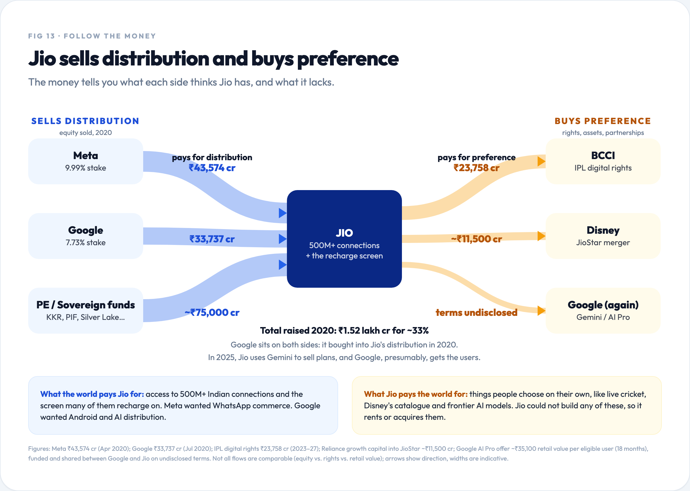

On the left, the world pays Jio for equity. Meta paid ₹43,574 crore, Google ₹33,737 crore, and private equity and sovereign funds roughly ₹75,000 crore more. They were buying **access to 500-million-plus Indian connections and the screen many of them recharge on.**

On the right, Jio pays for rights, assets and partnerships, which are different kinds of transaction: ₹23,758 crore for IPL rights, about ₹11,500 crore into the Disney merger, and an undisclosed arrangement with Google for Gemini. Jio is buying **things people choose on their own**, which it couldn't build.

Google sits on both sides. In 2020 it paid to get into Jio's distribution. In 2025 Jio uses Gemini to sell plans, and Google, presumably, gets the users.

> **Jio sells distribution and buys preference.**

---

## The economics underneath

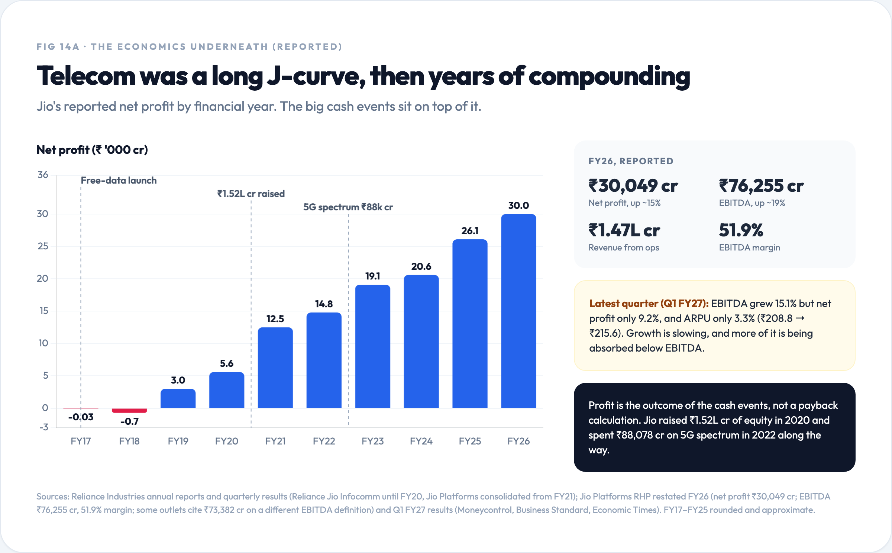

Jio's core business is one long J-curve: losses in FY17 and FY18, about ₹12,500 crore of profit by FY21, and **₹30,049 crore in FY26** (RHP restated) on ₹76,255 crore of EBITDA. (EBITDA here follows the RHP definition, a 51.9% margin. Some outlets cite ₹73,382 crore, which uses a different definition.) Along the way it raised ₹1.52 lakh crore in 2020 and spent ₹88,078 crore on 5G spectrum in 2022.

Each mode also has its own cash shape. The next chart is a conceptual model, not Jio data, and it doesn't imply any payback calculation.

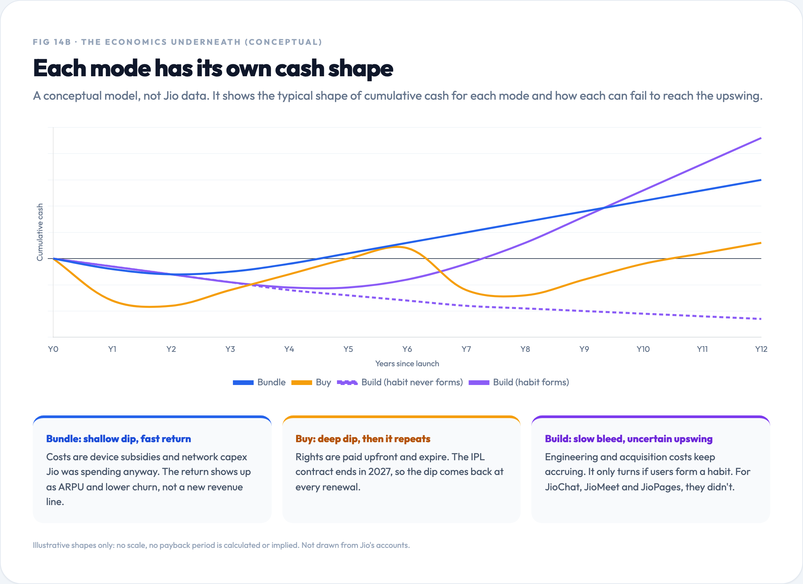

- **Bundle: a shallow dip and a fast return.** Costs are subsidies and capex Jio was spending anyway. The return attributable to any single bundle is hard to establish without product-level data.
- **Buy: a deep dip that comes back.** Rights expire. The IPL contract ends in 2027, so the dip returns at renewal.
- **Build: a slow bleed with an uncertain upswing.** It only turns if users form a habit.

Even a well-built Jio app faces worse economics than a bundle. It has to pay for habit. The bundle gets habit for free from the recharge cycle.

---

## So, telco or platform?

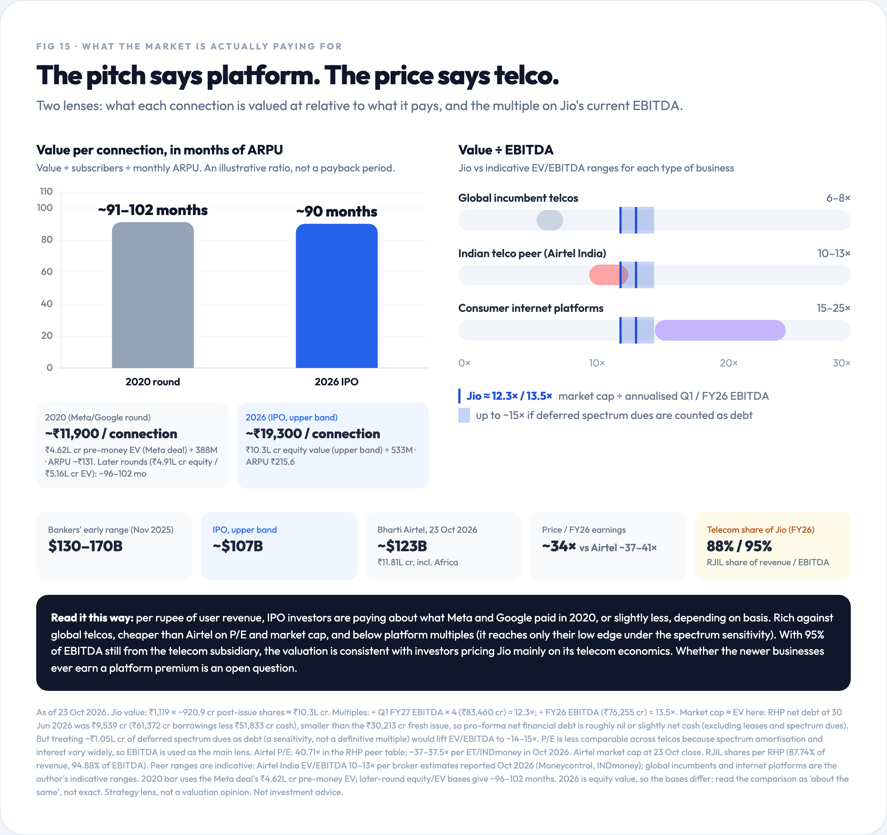

Start with the most important fact in the RHP. In FY26 the telecom subsidiary, Reliance Jio Infocomm, accounted for **87.74% of Jio Platforms' revenue and 94.88% of its EBITDA**. Whatever the pitch says, investors are mostly buying a telco. Two lenses, both rough, point the same way.

**Value per connection, in months of ARPU.** This is an illustrative ratio, not a payback period. In the 2020 Meta deal, Jio's pre-money enterprise value implied about ₹11,900 per subscriber, or about **91 months** of ARPU at ~₹131. Later 2020 rounds, on equity or enterprise value, work out to roughly 96–102 months. At the IPO's upper band, equity value is about ₹19,300 per connection, or about **90 months** at ₹215.6. Per rupee of user revenue, IPO investors are paying about the same as Meta and Google did in 2020, or slightly less. Six years of JioHotstar, JioMart and AI announcements haven't added a visible platform premium.

**Value relative to EBITDA.** ₹10.3 lakh crore is about **12.3×** annualised Q1 FY27 EBITDA, or **13.5×** FY26 EBITDA. That's market cap, but here it's close to enterprise value. The RHP put net debt at ₹9,539 crore in June 2026, less than the ₹30,213 crore the issue raises, so pro-forma net financial debt is roughly nil, or slightly net cash (excluding leases and spectrum dues). As a sensitivity, counting ~₹1.05 lakh crore of deferred spectrum dues as debt would lift it to ~14–15×. For context, broker estimates put Airtel's India business at about 10–13× EV/EBITDA. Global incumbent telcos sit lower, and consumer internet platforms sit well higher.

Jio trades at about 34× FY26 earnings, which sounds un-telco-like until you note that Airtel trades at about 37–41× (the RHP peer table shows 40.71×). On P/E, Jio is *cheaper* than Airtel. P/E is noisy across telcos because spectrum amortisation and interest vary so much, which is why EBITDA is the better lens here. Returns help explain the discount: Jio's return on net worth is about 9.4%, against Airtel's 20.3% (RHP peer table).

Three more reference points fit the same reading. Bankers floated $130–170 billion in late 2025. The IPO priced at about $107 billion. And Airtel was worth about ₹11.8 lakh crore, or roughly $123 billion, at the close on 23 October, a figure that includes its Africa business. Jio has far more connections in India than Airtel, yet it's listing below it.

**The reading: Jio is priced richly against global telcos, but below Airtel on P/E and market cap. The evidence is consistent with a valuation still anchored in telecom economics. The newer businesses may create strategic value, but their contribution isn't disclosed in enough detail to establish a separate platform premium.** That isn't a criticism of the IPO. It's a statement about what the non-connectivity scorecard has earned so far.

*(A strategy lens, not a valuation opinion. Nothing here is investment advice.)*

---

## The next test: AI

Reliance has been loud about AI: a large data centre in Jamnagar, a new unit called Reliance Intelligence, partnerships with Google and Meta, and, most visibly, Google AI Pro bundled free for 18 months on eligible Jio plans.

Read through the scorecard, there are four ways Jio could play AI. Rather than assign odds, I've ordered them by how much each leans on advantages Jio already has. The ordering is my judgement.

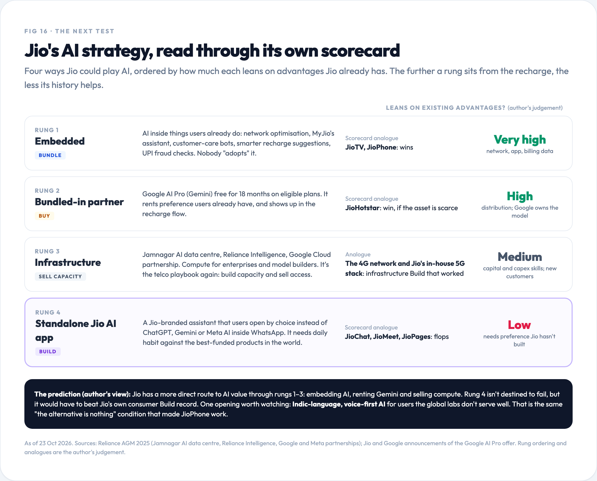

**Rung 1: Embedded (Bundle).** AI inside things users already do: network optimisation, the MyJio assistant, customer care, recharge suggestions, UPI fraud checks. Nobody has to adopt it. This leans hardest on Jio's existing advantages.

**Rung 2: Bundled partner (Buy).** The Gemini offer. It rents preference users already have and places it in the recharge flow, like JioHotstar. The catch is that Google, not Jio, owns the model and the user relationship.

**Rung 3: Infrastructure (sell capacity).** Data centres and compute for enterprises and model builders. This is the telco playbook again, and the one place where Jio's infrastructure Build record (4G, the 5G stack) applies directly. It's capital-heavy and the customers are new.

**Rung 4: A standalone Jio AI app (Build).** A Jio-branded assistant people open by choice instead of ChatGPT, Gemini, or Meta AI inside WhatsApp. It needs daily habit against the best-funded products in the world. The analogues are JioChat, JioMeet and JioPages.

### The AI math problem

There's also an economic reason AI differs from what Jio has bundled before. I covered the general version of this in [my July piece on AI pricing](https://thedeconstructed.substack.com/p/when-your-best-customers-become-your); here's the Jio-specific one.

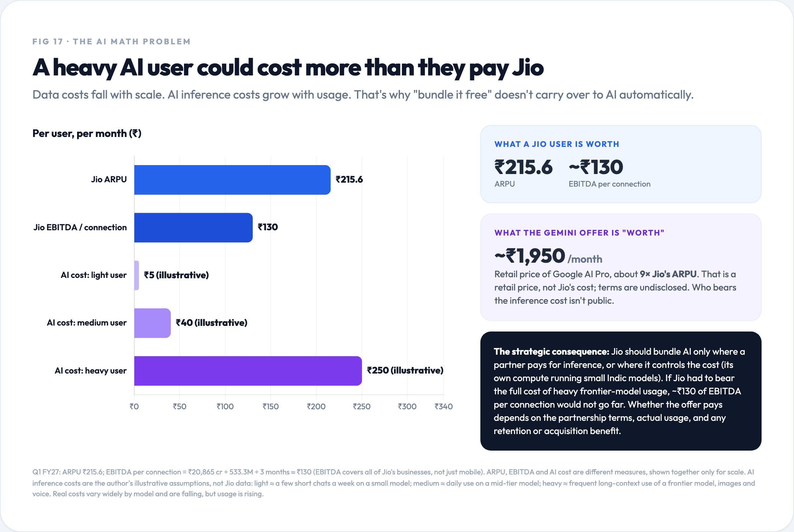

Three different numbers are worth keeping apart:

- **ARPU** is what a connection pays Jio: ₹215.6 a month.
- **EBITDA per connection** is about ₹130 a month (₹20,865 crore of Q1 EBITDA ÷ 533 million ÷ 3). It covers all of Jio's businesses, not just mobile.
- **AI inference cost** is what serving one user's AI usage costs. My figures here are illustrative scenarios, not Jio data.

Data got cheaper with scale, which is why "bundle it free" worked for data and video. Inference cost grows with usage. A light user might cost a few rupees a month. A heavy frontier-model user, with long conversations, images and voice, could cost more than they pay Jio.

The Gemini offer shows the gap. Google AI Pro retails for about ₹1,950 a month, about **nine times Jio's ARPU**. That's a retail price, not Jio's cost. The terms are undisclosed, and who bears the inference cost isn't public.

**The consequence:** Jio should bundle AI where a partner pays for inference, or where it controls the cost (its own compute running small, efficient Indic models). If Jio had to bear the full incremental cost of heavy frontier-model usage, giving it away could become commercially unattractive. Average EBITDA per connection isn't the budget available for AI subsidies, but it shows the scale: ₹130 a month doesn't stretch far against heavy usage. Whether the offer pays depends on the negotiated terms, actual usage, and what it does for acquisition and retention.

### The prediction

> **Jio has a more direct route to AI value through rungs 1 to 3:** embedding AI, renting Gemini and selling compute. Rung 4, a standalone consumer AI app competing on its merits, isn't destined to fail, but it would have to beat Jio's own consumer Build record.

One exception is worth watching: **Indic-language, voice-first AI** for users the global labs don't serve well. That's the condition that made JioPhone work. When the alternative is nothing, Jio's distribution wins.

---

## What would prove this wrong

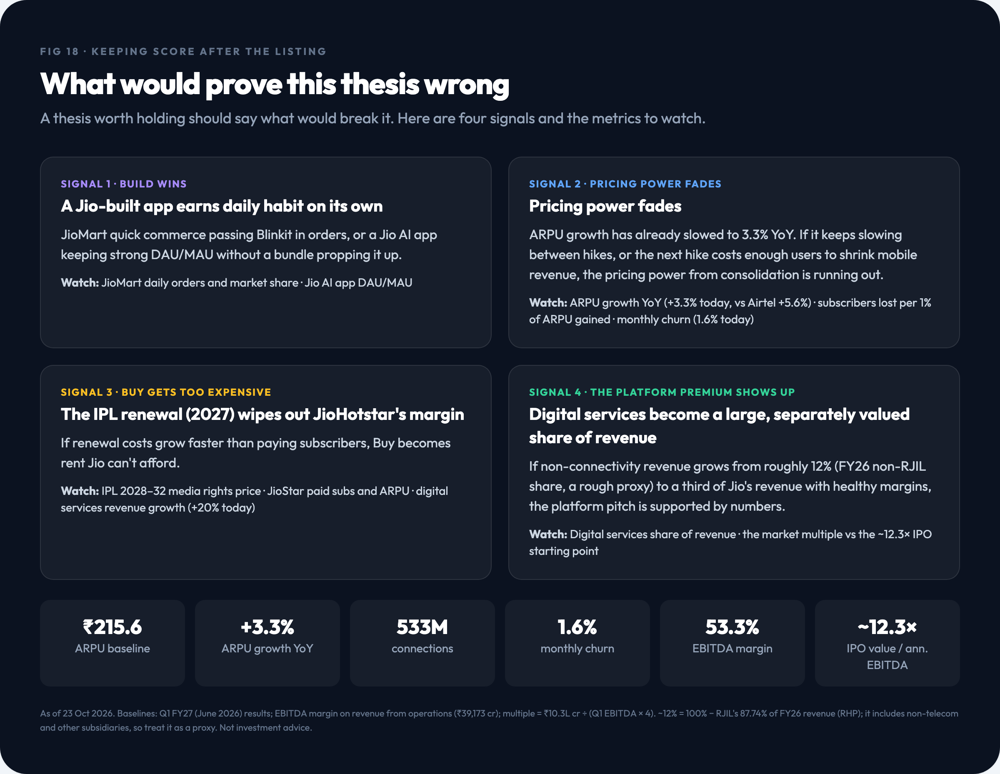

1. **Build wins.** A Jio-built consumer app earns daily habit on its own: JioMart quick commerce overtakes Blinkit in orders, or a Jio AI app holds strong daily-to-monthly usage without a bundle.
2. **Pricing power fades.** ARPU growth has already slowed to 3.3%, against Airtel's 5.6%. If it keeps slowing between hikes, or the next hike costs enough users to shrink mobile revenue, the consolidation dividend is running out.
3. **Buy gets too expensive.** The 2027 IPL renewal wipes out JioHotstar's margin.
4. **The platform premium shows up.** Non-telecom revenue grows from roughly 12% today (the FY26 non-RJIL share, a rough proxy) to a third of revenue with healthy margins, and the market pays well above the ~12.3× starting multiple.

Baselines: ARPU ₹215.6 (+3.3% YoY), 533 million connections, 1.6% monthly churn, a 53.3% EBITDA margin on revenue from operations, and ~12.3× market cap to annualised EBITDA. Check back in a year.

---

## The takeaway

Ten years and twelve consumer bets give Jio a clear scorecard.

- It is **excellent at Bundle**. When a product rides the recharge, Jio is close to unbeatable in India.
- It is **good at Buy** when the asset is scarce, and average when it isn't.
- It has had **far less success building standalone consumer products**, even as it has built world-class infrastructure.

The price pays for the bundle machine, not for a consumer platform. That seems fair.

Jio doesn't need to become a *technology* platform. It can become a *distribution* platform: the screen half a billion connections return to every recharge cycle, where Google, Disney, the BCCI and whoever wins AI pay to be seen.

That's a different business from the one in the pitch deck. It might be a better one.

---

## Appendix: Sources, method and caveats

**Sources.** Jio Platforms DRHP/RHP (objects of the issue, shareholding); final-day exchange subscription data as reported by Mint, Economic Times and Business Standard (23 Oct 2026); Reuters on 1.38 crore applications; ET Now and BusinessLine on the first IPO globally past one crore; RHP peer comparison table (P/E, RoNW) and segment data (RJIL share of revenue and EBITDA); Jio Platforms FY26 and Q1 FY27 results (Moneycontrol, Business Standard, Economic Times); Reliance Industries annual reports; Bharti Airtel Q1 FY27 results and market data (23 Oct 2026 close, per Dhan market-cap history; ₹11.78L cr on 21 Oct per Goodreturns); JioStar Q1 FY27 results (Variety, Storyboard18); broker valuation comparisons as reported by Moneycontrol and INDmoney (Oct 2026); Business Standard and Business Today on bankers' $130–170B range (Nov 2025); TRAI subscription and performance-indicator reports (prepaid share 90.14%, Mar 2026); TRAI per-GB wireless data cost series (press release, Aug 2019); company announcements for the 2020 Meta, Google and PE investments; BCCI media-rights results (2022); Reliance–Disney JioStar announcements; JioHotstar subscriber milestones (ET, Variety, Financial Express, 2025); Jio and Google announcements on the Google AI Pro offer; grey-market premium as reported by News18 and GMP trackers on 23 Oct 2026 (unofficial).

**Key numbers.** Value = ₹1,119 × ~920.9 crore post-issue shares ≈ ₹10.3 lakh crore. Subscription: 22.19× overall, excluding the anchor book; QIB 70.55× on the ~4.90 crore shares left after 7.24 crore went to anchors; NII ~14×, retail 2.72×. Ex-anchor bids ≈ 438 crore shares × ₹1,119 ≈ ₹4.9 lakh crore (author's arithmetic; reported totals including anchors are higher). Use of proceeds: up to ₹27,500 crore (~91%) to repay Reliance Jio Infocomm borrowings. FY26 (RHP restated): net profit ₹30,049 crore, EBITDA ₹76,255 crore (51.9% margin; some outlets cite ₹73,382 crore on a different definition). RJIL share of FY26 consolidated revenue 87.74%, EBITDA 94.88%. Net debt at 30 June 2026: ₹9,539 crore (₹61,372 crore borrowings less ₹51,833 crore cash and investments; RHP), excluding ₹1,04,514 crore of deferred spectrum dues and ₹12,168 crore of leases. Q1 FY27: revenue from operations ₹39,173 crore, EBITDA ₹20,865 crore (53.3% margin on revenue from operations), net profit ₹7,764 crore, ARPU ₹215.6, 533.3 million connections.

**Method.** Mode = the dominant strategic investment mode (author's assessment). Reuse (x) and preference (y) are scored 0–10 using the rubric on Fig 7. Outcomes use the per-product "win if" criteria on Figs 8a and 8b, judged as of October 2026, with an evidence rating for each. They measure adoption and competitive position, not standalone financial return. 2020 value-per-subscriber uses the Meta deal's pre-money EV (~91 months); later rounds give ~96–102 months depending on basis. The spectrum-adjusted multiple is a sensitivity, not a headline. The scope is consumer products; infrastructure is excluded. All placements are the author's judgement, made with hindsight.

**Caveats.** Historical profit, ARPU, market-share and per-GB series are rounded. JioPhone and JioPhone Next sales are not officially disclosed. JioHotstar subscriber figures include telco bundles. Peer multiples are indicative and move daily. AI cost figures (₹5, ₹40, ₹250) are illustrative scenarios. The UI images in Figs 5, 10, 11 and 12 are recreations, not screenshots.

**Disclaimer.** This is a product and business strategy case study. It is not investment advice, a recommendation to buy or sell any security, or a valuation opinion.

*— Deconstructed*
