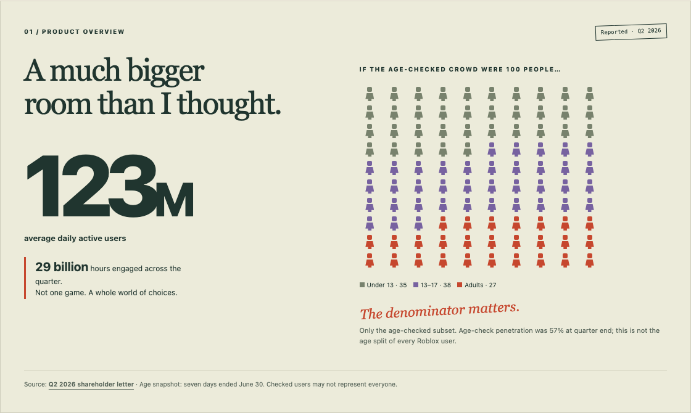
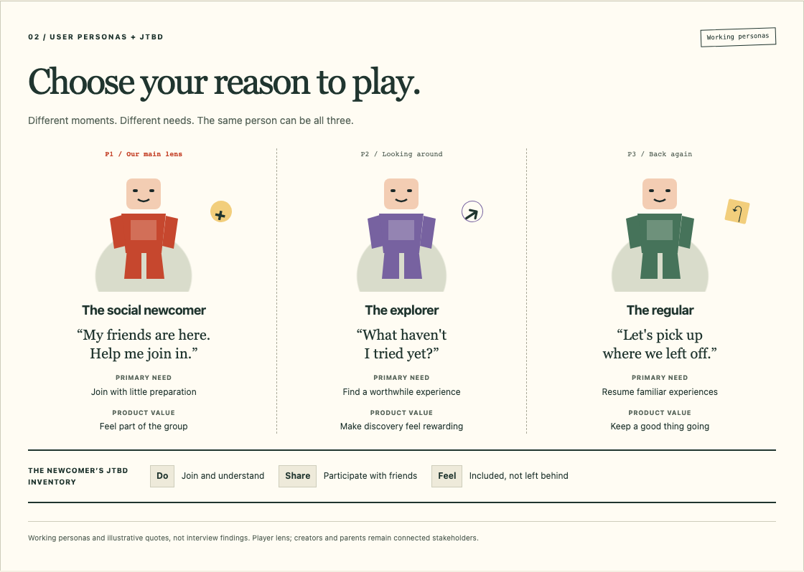
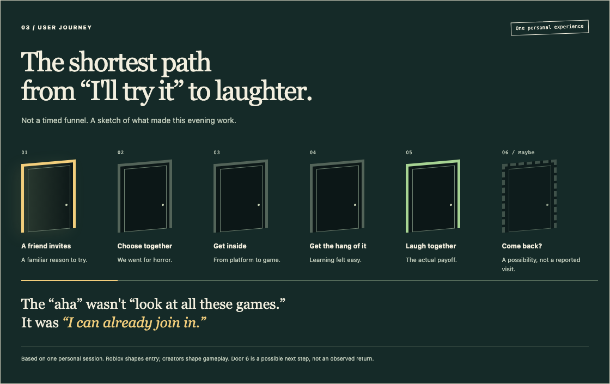
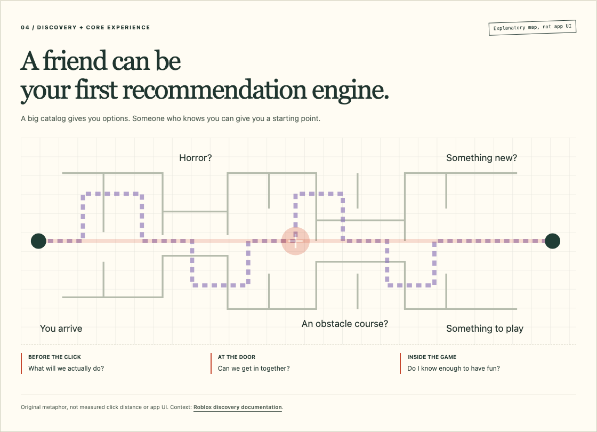
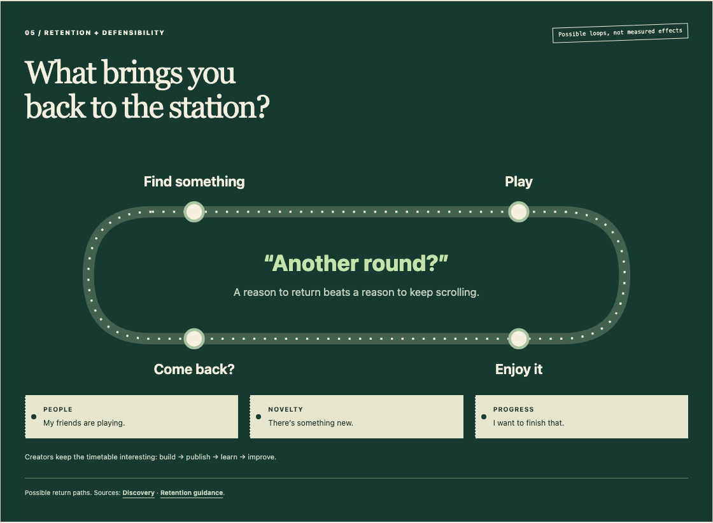
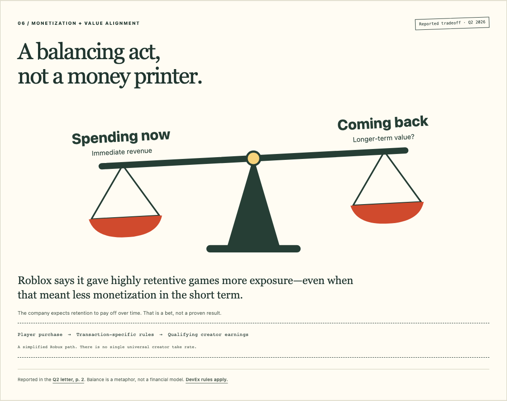
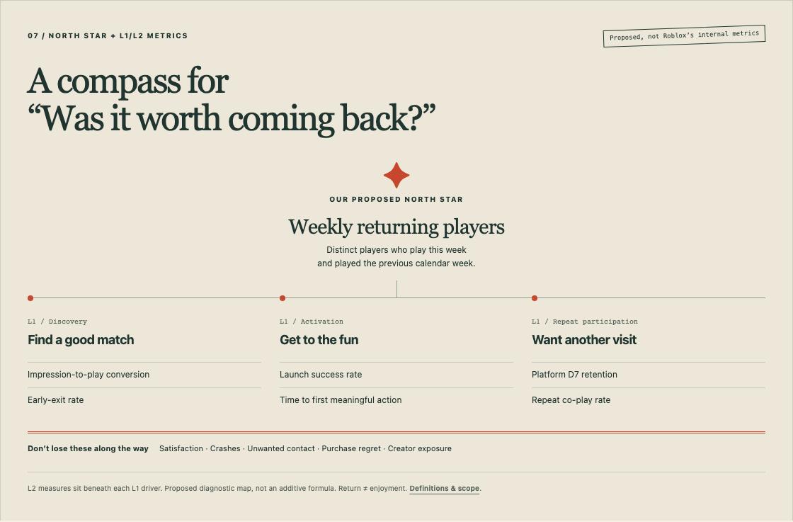
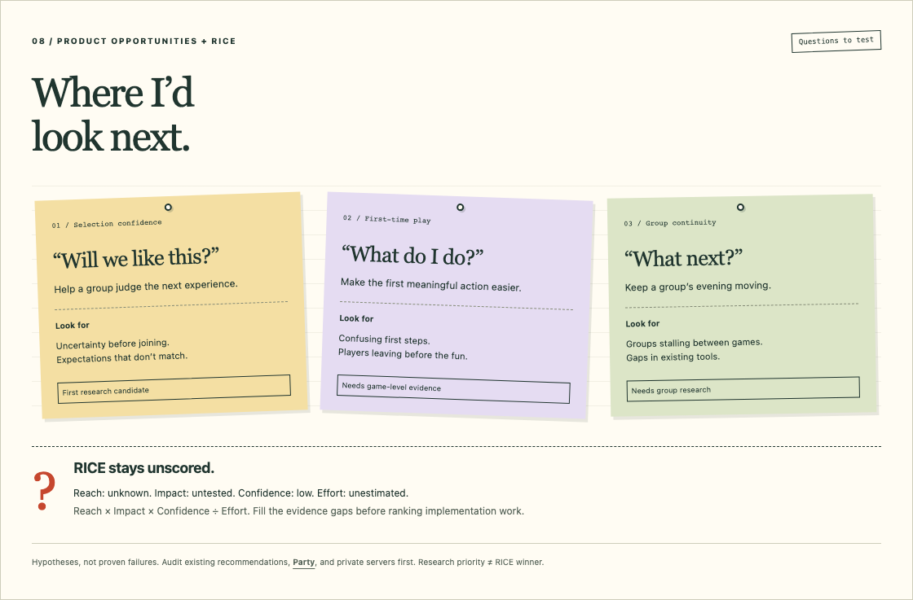
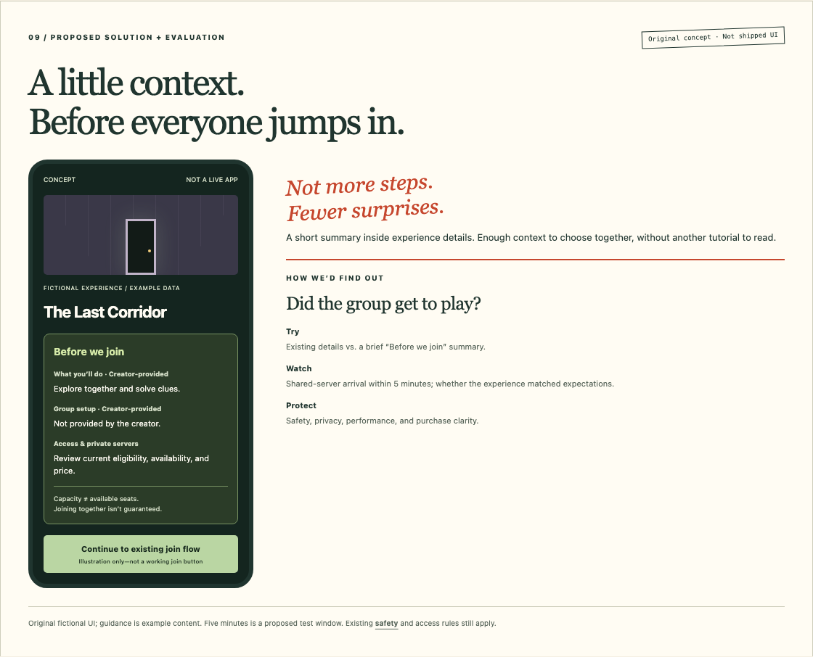

# Roblox: I Came for a Game. I Stayed for the Company.

*A product teardown of what gets us in, what makes it fun, and what brings us back.*

A friend introduced me to Roblox. Until then, I'd thought of it as a game for children. Not really something for me.

Then I joined my friend and a group for a horror game.

There was a lot of laughter. What surprised me just as much was how easy it felt to get the hang of it. I wasn't spending the evening figuring out how to play. I was already part of the fun.

That changed my mind. Roblox could be immersive and entertaining for adults, too.

And it left me curious: **what makes that first good evening happen—and how does Roblox help it happen again?**

## 1. Product Overview & Positioning

The first thing I had wrong: Roblox isn't one game. It's a platform where creators build experiences and players find something to play.

Its competition depends on what you came for. If you're looking for a challenge, another multiplayer game might do. If you're looking for an evening with friends, the alternative might simply be hanging out somewhere else.

In Q2 2026, Roblox reported **123 million average daily active users** and **29 billion hours engaged**. Adults made up 27% of its age-checked DAUs—not all users. That distinction matters; the checked group doesn't necessarily represent everyone.[1]

*A bigger room than I expected. The crowd illustration keeps the age-data denominator visible.*

> **A look at Roblox in motion:** [Watch The Hunt: Mega Edition trailer, published by Roblox](https://www.youtube.com/watch?v=I7pmbho1DUQ). It's a promotional glimpse of a past event—not footage of my session or a typical evening. The [visual companion](visuals.html#footage) includes the official player.

## 2. User Personas & Jobs-to-Be-Done

People can open the same app wanting very different things.

| Working persona | What they're really asking |
|---|---|
| **The social newcomer** | “My friends are here. Help me join in without a lot of preparation.” |
| **The explorer** | “I've got some time. Help me find something worth trying.” |
| **The regular** | “Let me pick up the games and connections I care about.” |

I'm closest to the newcomer in this story. The job wasn't just “play a horror game.” It was **spend a good evening with people, without needing to become an expert first**.

That's functional, social, and emotional: understand enough to play, take part with friends, and not feel left behind.

*Working personas, not interview findings. Creators and parents matter too; the player journey is this teardown's focus.*

## 3. User Journey & Core Experience

My journey was straightforward:

**A friend invites → we choose → we enter → I get the hang of it → we have fun.**

The important moment wasn't seeing how much Roblox offered. It was realizing I could participate almost immediately.

There's a handoff here worth noticing. Roblox helps people find and enter experiences. Creators largely decide what happens once they're inside. One approachable horror game doesn't mean every experience is equally easy to learn.

Roblox's own creator guidance encourages getting players to the fun quickly rather than putting a long tutorial in the way.[2] This session showed me why that matters.

*The evening as a corridor—not a measured funnel.*

*Sometimes a friend is your first recommendation engine.*

## 4. Retention Loop & Defensibility

Having fun once and coming back aren't the same thing.

The next visit might be about friends. Or a new experience. Or unfinished progress. A useful loop is **find something → enjoy it → have a reason to return**.

Creators keep adding possibilities; familiar experiences and relationships can give players continuity. Those reinforce each other when the match is good—not simply because the catalog gets bigger.

Roblox already considers intentional co-play in recommendations.[3] The question isn't whether social play exists. It's how reliably people reach it.

*Three tickets back: people, novelty, and progress.*

> **Behind the recommendations:** [Roblox Creators explains “Recommended for You”](https://www.youtube.com/watch?v=K7jsk3bzmvE). It's the company's explanation, not an independent verdict. Current signals live in its [discovery documentation](https://create.roblox.com/docs/discovery).

## 5. Monetization & Value Alignment

There are plenty of ways to spend: passes, items, subscriptions, private servers. Eligible creators can exchange qualifying Earned Robux through DevEx.[4][5]

But “more spending” isn't the whole product story.

In its Q2 letter, Roblox said it gave highly retentive games more exposure at the expense of near-term monetization.[1] In other words: it accepted some pain now in the hope that people would keep coming back.

That's an interesting bet. It isn't proof the bet will pay off.

*The balance is a metaphor, not a financial model. There is no universal creator take rate across every transaction.*

## 6. North Star, L1/L2 Metrics & Guardrails

I'd start with **weekly returning players**: people who played this week and the previous week.

It's a useful sign that Roblox earned another visit. It doesn't tell us whether that visit was enjoyable, so satisfaction and safety need to sit alongside it.

| L1: what should work? | L2: what would I look at? |
|---|---|
| Find a worthwhile match | Impression-to-play conversion; early exits |
| Get to the fun | Launch success; time to a meaningful first action |
| Have a reason to return | Platform D7 retention; repeat co-play |

I'd also watch crashes, unwanted contact, purchase regret, and whether discovery exposure becomes overly concentrated. Longer sessions don't excuse a worse experience.

*My proposed diagnostic map, not Roblox's internal North Star. Returning to Roblox and returning to one particular experience are different measures.[6]*

## 7. Product Opportunities & Prioritization

Three questions seem worth taking into real sessions:

**“Will we like this?”** Can a group tell what an experience will be like before joining?

**“What do I do?”** Where do newcomers lose their way between entering and actually playing?

**“What next?”** What happens when the group finishes and wants to try something else?

I'd investigate the first one first. It fits the newcomer journey and is small enough to prototype. That doesn't make it the biggest problem.

RICE comes after evidence: how many people struggle, how much a change helps, how confident we are, and what it takes to build. Scoring those now would look precise without being useful.

*Research quests, not a list of proven failures. Recommendations, Party, and private servers already exist.[3][7][8]*

## 8. Proposed Solution & Evaluation

I'd test a small **“Before we join”** summary inside experience details.

What will we do? What group setup does the creator recommend? Where do we check access and private-server information?

Nothing grand. Just enough context to make a shared choice easier. First, check whether the current interface already answers these questions.

Missing information should stay missing. A player limit isn't a promise that everyone will find a seat together.

Compare existing details with the summary for eligible adult groups. Assign groups before showing either version, then measure how many reach a shared server within five minutes—including those who never join. Ask whether the experience matched expectations, too.

Set the sample size, meaningful improvement, and guardrail limits before testing. Five minutes is a proposed window, not a known benchmark.

*An original concept, not shipped Roblox UI. All age, privacy, and parental controls still apply.*

## Final Take

I thought I was trying a game that wasn't for me. What I found was an easy way to have fun with a group.

That's what I'd want Roblox to keep getting right: **help us find something, get us into the fun, and give us a good reason to do it again.**

---

### Sources & publication notes

Research checked October 29, 2026. This is a personal, research-informed teardown—not a representative user study or authenticated app audit. Personas and opportunities are hypotheses; no internal analytics or experiment results are claimed. Financial figures use a dated Q2 snapshot. Refresh figures and interface evidence before publication.

1. [Roblox Q2 2026 shareholder letter](https://s27.q4cdn.com/984876518/files/doc_financials/2026/q2/Roblox-Q2-2026-Earnings-Shareholder-Letter.pdf), July 30, 2026: pp. 2, 4–6, 8–9, and age-check note, p. 18. Age composition covers the seven days ended June 30. Age-check penetration was 57%; the checked subset may not represent all users. Evolving estimates aren't directly comparable with historical self-reported ages.
2. [Creator Hub: Onboarding](https://create.roblox.com/docs/production/game-design/onboarding). Guidance for creators, not proof every game follows it.
3. [Creator Hub: Discovery](https://create.roblox.com/docs/discovery). Signals evolve. Their inclusion doesn't prove causal impact.
4. [Creator Hub: Monetization](https://create.roblox.com/docs/production/monetization). Transaction types and economics differ.
5. [Creator Hub: Developer Exchange](https://create.roblox.com/docs/production/monetization/developer-exchange). Eligibility and qualifying Earned Robux restrictions apply.
6. [Creator Hub: Retention](https://create.roblox.com/docs/production/analytics/retention). Its published retention measures concern individual experiences. Our platform-level diagnostic map is not an additive formula; [expand the companion's definitions](visuals.html#metric-definitions) for denominators and scope. Use fixed calendar weeks/timezone, attribution windows, and cohorts.
7. [Roblox Help: Unlocking trusted friends](https://en.help.roblox.com/hc/en-us/articles/37725513985812-Unlocking-trusted-friends). Party exists; communication access varies by age, region, and eligibility.
8. [Creator Hub: Private servers](https://create.roblox.com/docs/production/monetization/private-servers) and [Roblox Safety](https://about.roblox.com/safety).

**Media:** The two videos are verified uploads from Roblox and Roblox Creators. They are publicly viewable, **not verified public-domain assets**. Use original-source links or the official player; don't download or turn them into GIFs without separate reuse permission. The trailer is promotional footage, not my horror-game session or evidence of current UI. Video links can be pasted into Substack; verify embed support before publishing. [Media provenance](media-sources.json).

**Original visuals:** [Open the interactive field guide](visuals.html). PNG exports in `assets/` are embedded above. Block characters, maps, scenery, and the fictional phone UI are original explanatory illustrations—not Roblox screenshots. The actual horror experience and device remain unspecified. The [full experiment design](visuals.html#experiment-notes) sits outside the artwork so the visuals stay easy to read.
