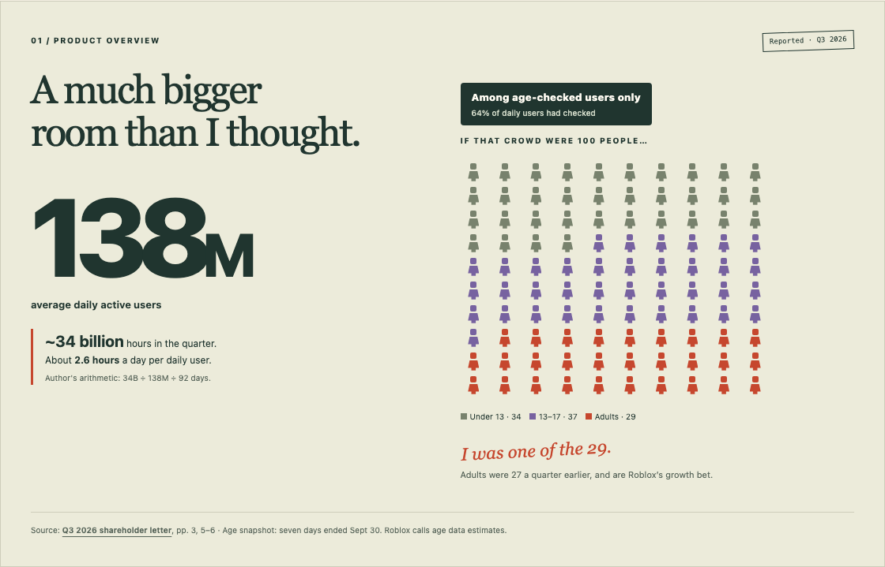
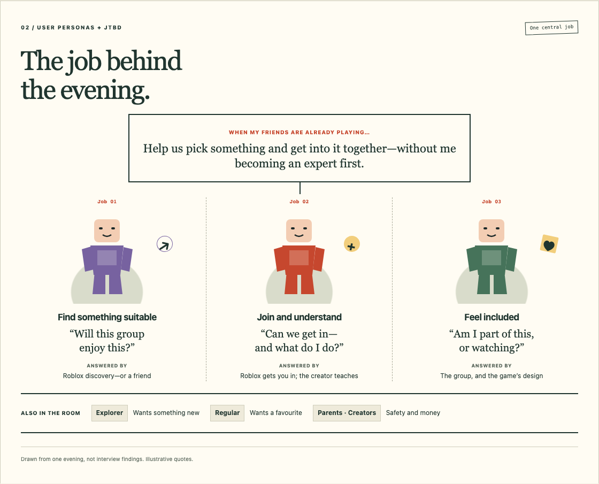
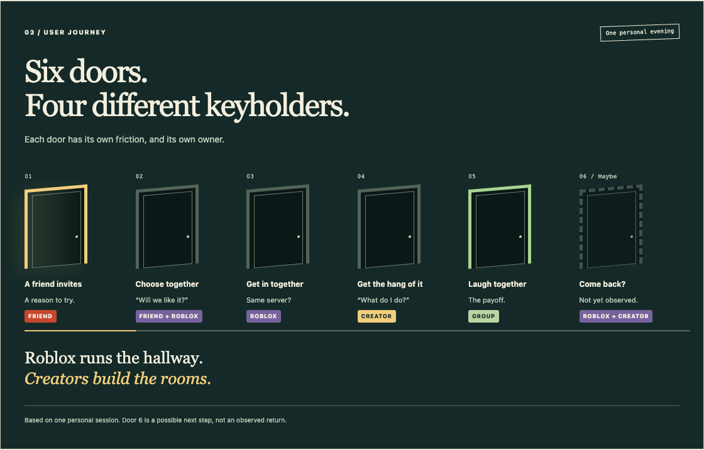
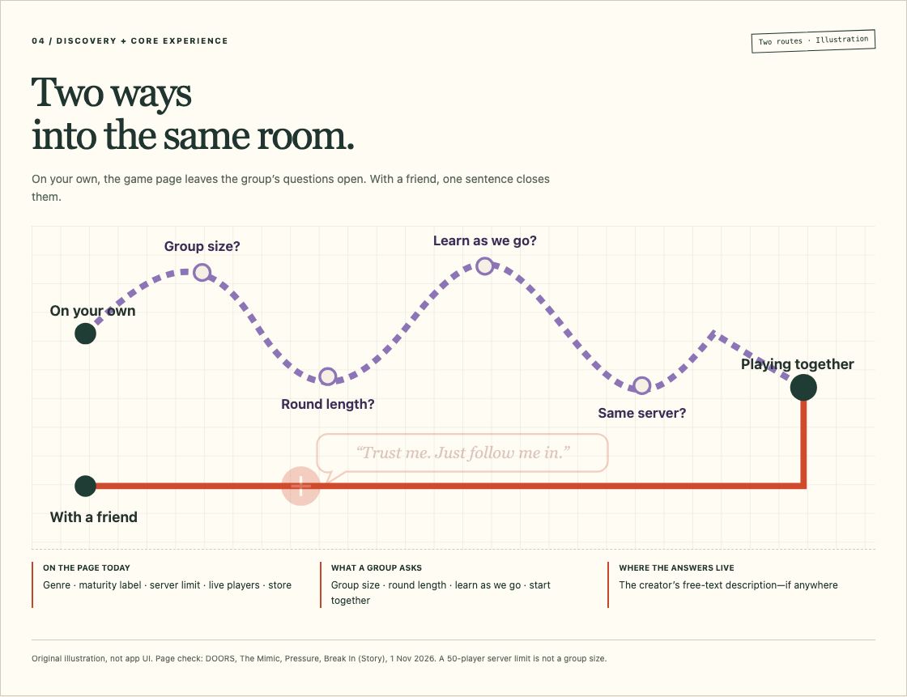
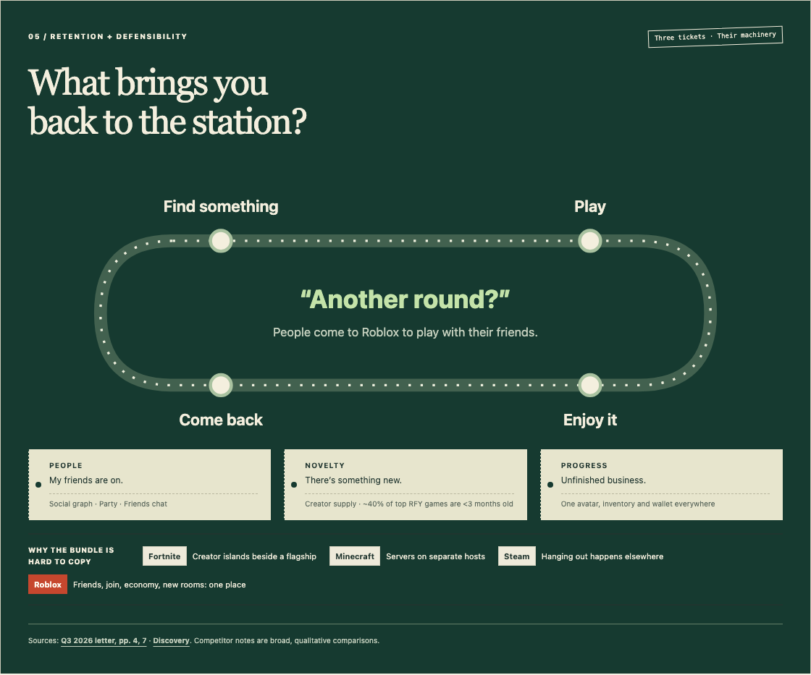
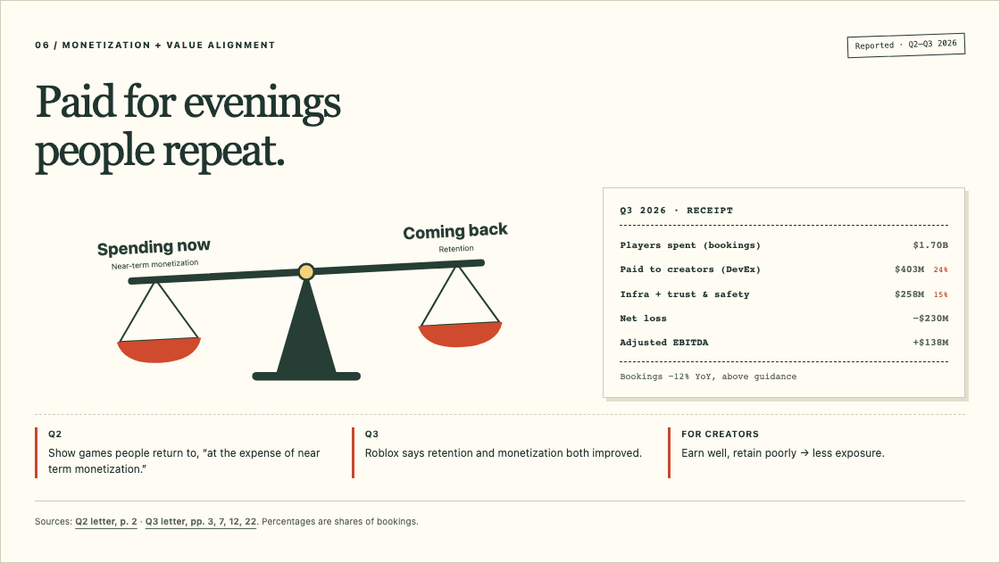
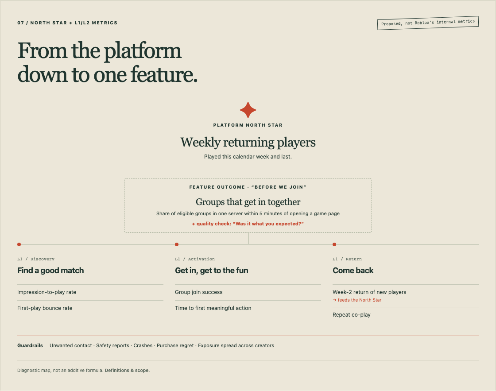
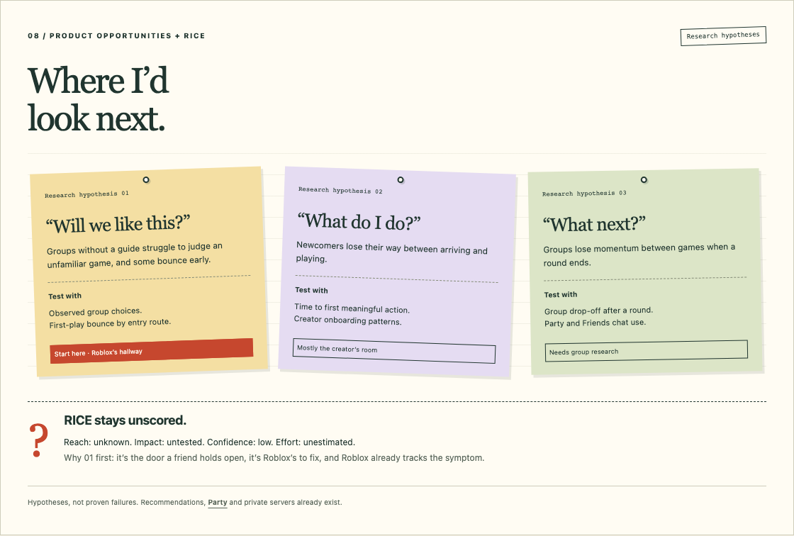
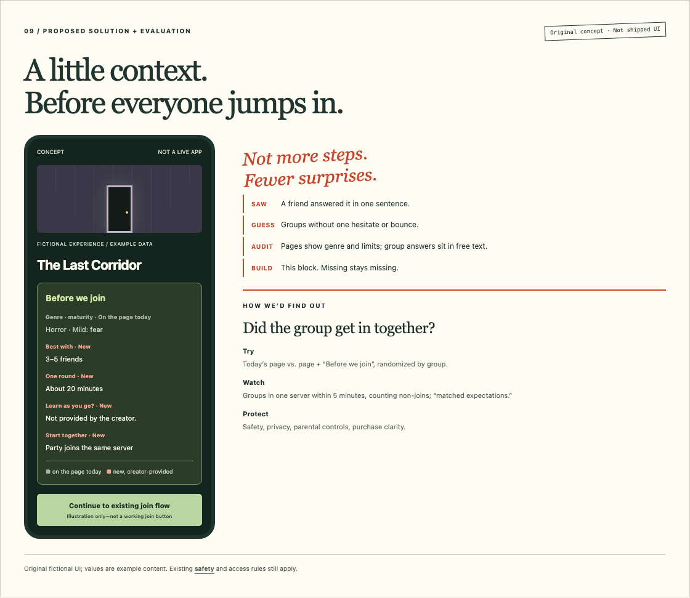

# Roblox: I Expected a Kids' Game. I Found Good Company.

*A product teardown of the hallway Roblox runs, the rooms creators build, and the friend who walked me between them.*

A friend introduced me to Roblox. Until then, I'd filed it under "games for children." Not for me.

Then I joined my friend and a group for a horror game.

There was a lot of laughter. What surprised me just as much was how little I had to learn. I wasn't spending the evening working out the controls. I was already part of the fun.

Looking back, three parties made that happen. Roblox got us into the same game. The creator made it easy to pick up. And my friend did what no algorithm did: picked something, vouched for it, and pulled me in.

That became the lens for this teardown: **Roblox runs the hallway; creators build the rooms.** And the question I kept returning to: *how does Roblox help a group get from "what should we play?" to having fun together—especially when nobody in the group already knows the way?*

## 1. Product Overview & Positioning

The first thing I had wrong: Roblox isn't one game. It's millions of experiences built by independent creators, behind one front door.

Roblox owns the hallway: account and avatar, discovery, friends and chat, getting everyone into a server, safety, and Robux. Creators own the rooms: what you do, how you learn it, what's for sale. Roblox can't design every room, but it decides which doors get shown and what creators earn when people walk through.

The scale is hard to picture. In Q3 2026, Roblox averaged **138 million daily active users**, who spent **nearly 34 billion hours** on the platform. By my arithmetic, that's about 2.6 hours per daily user, every day.[1]

And I was the minority in that room. Among users who have completed an age check, 34% are under 13, 37% are 13–17, and **29% are adults**.[1] That share is climbing (27% a quarter earlier), and Roblox is chasing it on purpose: in the US, adults spend about 50% more than younger players. So "Roblox works for adults" isn't a settled fact. It's the company's growth plan.

*If the age-checked crowd were 100 people. By quarter end, 64% of daily users had completed an age check.*

> **A look at Roblox in motion:** [Watch The Hunt: Mega Edition trailer, published by Roblox](https://www.youtube.com/watch?v=I7pmbho1DUQ). It's a promotional glimpse of a past event, not footage of my evening. The [visual companion](visuals_v3.html#footage) includes the official player.

## 2. User Personas & Jobs-to-Be-Done

The explorer wants something new; the regular wants a favourite. But one job sat under my evening, and probably under many first evenings:

> **When my friends are already playing, help us pick something and get into it together—without me having to become an expert first.**

It breaks into three smaller jobs, each with a different owner:

| Smaller job | The question in my head | Who mostly answers it |
|---|---|---|
| **Find something suitable** | "Will this group enjoy this?" | Roblox's discovery—or a friend |
| **Join and understand** | "Can we get in together, and what do I do?" | Roblox gets you in; the creator teaches you |
| **Feel included** | "Am I part of this, or just watching?" | The group, and the game's design |

Parents and creators matter too; they enter through safety and money.

*One central job, three smaller ones. Drawn from one evening, not from interviews.*

## 3. User Journey & Core Experience

My evening, as six doors:

**A friend invites → we choose → we get in → I get the hang of it → we laugh → maybe we come back.**

Each door has a different keyholder. The invitation came from a person. The choice happened on Roblox, but really on my friend's say-so. Getting in together was Roblox's plumbing. Getting the hang of it was the creator's craft; Roblox tells creators to get players to the fun before any tutorial, and this game listened.[2] The laughter was the group's. The aha wasn't how much Roblox offered. It was that I could join in straight away.

*Who holds each door. The sixth is a possibility; I haven't counted return visits.*

The second door is where I'd have stalled on my own. I checked the public pages of four popular horror games: DOORS, The Mimic, Pressure and Break In.[3] They show genre, a maturity label ("Fear: mild"), the server's player limit, live players and a store. What a group wants to know—best group size, round length, whether you can learn as you go, whether friends start together—is missing or buried in the creator's description. A 50-player server limit isn't a group size. My friend answered all of it in one sentence.

*Two ways into the same room. A friend fills in what the game page leaves out.*

## 4. Retention Loop & Defensibility

Three things bring people back: **people** (my friends are on), **novelty** (there's something new), and **progress** (unfinished business). Each one rests on machinery that Roblox controls:

- **People → the social graph.** Friends, Party and chat follow you from game to game. Roblox puts it plainly: people "come to Roblox to play with their friends."[1]
- **Novelty → creator supply plus discovery.** About 40% of the top 100 games in "Recommended for You," ranked by weekly impressions, were made in the past three months.[1]
- **Progress → one identity everywhere.** One avatar, one inventory and one Robux wallet across every room.

That bundle is the moat. Fortnite has creator islands, but they sit beside Epic's own flagship game. Minecraft's community servers are scattered across separate hosts and rules. Steam sells games brilliantly, but the hanging out happens elsewhere. Roblox puts the friends list, instant join, economy and an endless supply of new rooms in one place. Any piece can be copied; the whole bundle, plus the friends already inside, is much harder.

*Three tickets back, and the machinery behind each one.*

> **Behind the recommendations:** [Roblox Creators explains "Recommended for You"](https://www.youtube.com/watch?v=K7jsk3bzmvE). It's the company's own explanation; current signals live in its [discovery documentation](https://create.roblox.com/docs/discovery).

## 5. Monetization & Value Alignment

Players buy Robux and spend them on passes, items, subscriptions and private servers; creators earn a share and can cash out through the Developer Exchange (DevEx).[4][5] One quarter, from the Q3 2026 letter:[1]

| Q3 2026 | |
|---|---|
| **Bookings** (what players spent) | $1.70B — down 12% year over year, above guidance |
| **Paid to creators** (DevEx) | $403M — 24% of bookings |
| **Infrastructure and trust & safety** | $258M — 15% of bookings |
| **Net loss / adjusted EBITDA** | −$230M / +$138M |
| **Monthly unique payers** | 30M |

The most interesting decision in that quarter was made a quarter earlier. In Q2, Roblox retuned "Recommended for You" to give **more exposure to games people keep coming back to, at the expense of near-term monetization**.[6] It now weighs a 28-day window and how often first-time players leave within 30–90 seconds without really playing. It hurt: Q2 bookings landed at the low end of guidance.

In Q3, Roblox says the bet started paying back. The retuned recommendations "drove meaningful improvements in overall platform retention and monetization," and bookings per hour grew again.[1] Bookings are still down year over year and Q4 guidance is lower again, so it's early. But the direction is clear: Roblox wants to earn from evenings people repeat, not one-off spending.

That changes the brief for creators. The obvious worry is that retention-first discovery hands everything to a few hits, yet the top 10 games fell from about 30% of hours to 20% over three years.[6] The real pressure is on games that earn well but don't hold people: they lose exposure. The carrot is higher DevEx rates for US adult spending and novel games.[1][6]

*The Q3 receipt, and the bet behind it.*

**Safety is part of the value, not a footnote.** Most users are children and adults are the growth target, so it has to be. Chat now requires an age check: 64% of daily users had done one by Q3, including more than 80% of 13–17-year-olds. Chat is grouped by age, image sharing is restricted, and Kids and Select accounts give younger players a narrower catalogue.[1][6]

The tension: Roblox says much of its co-play talk has happened on off-platform apps that "may not align with our safety standards."[6] Its answer is to bring the conversation home with Friends chat, voice and Quick Words; users chatting or on voice grew 24% in a quarter.[1] As an adult newcomer, I barely noticed. For a parent, it's the whole product.

## 6. North Star, L1/L2 Metrics & Guardrails

Two levels, which my first draft blurred.

**Platform North Star: weekly returning players**—people who played this calendar week and last. It shows Roblox earned another visit, not that the visit was good, so it travels with quality and safety checks.

**Feature outcome (for section 8): groups that get in together**—the share of eligible groups opening a game page who land in the same server within five minutes, paired with a one-tap "Was it what you expected?" check.

| L1: what has to work? | L2: what I'd watch |
|---|---|
| Find a good match | Impression-to-play rate; first-play bounce rate |
| Get in and get to the fun | Group join success; time to first meaningful action |
| Come back | Week-2 return for new players; repeat co-play |

The last row feeds the North Star directly: a new player who returns in week two becomes a weekly returning player. That's why I swapped D7 retention for week-2 return.

**Guardrails:** unwanted contact and safety reports, crashes, purchase regret, and how widely exposure is spread across creators.

*Platform outcome → feature outcome → quality check → guardrails. My proposal, not Roblox's internal metrics.*

## 7. Product Opportunities & Prioritization

Three research hypotheses, each tied to something I saw:

**01 — "Will we like this?"** Groups without a guide struggle to judge an unfamiliar game before joining, and some bounce in the first minute because it wasn't what they expected.

**02 — "What do I do?"** Newcomers lose their way between arriving and actually playing. This is mostly creator territory; Roblox's levers are tools and guidance.

**03 — "What next?"** Groups lose momentum between games when a round ends.

I'd start with 01. It's the door my friend held open, so people without that friend are most exposed. It sits in Roblox's hallway, not a creator's room. And Roblox already measures the symptom: first-play bounce is now a recommendation signal.[6] If some bounces mean "we picked the wrong room," better information before the click is cheaper than a better guess after it.

RICE comes after evidence. Reach, impact and confidence need data I don't have, so it stays unscored.

*Hypotheses to test, not proven failures. Recommendations, Party and private servers already exist.[7][8]*

## 8. Proposed Solution & Evaluation

A short **"Before we join"** block on the game page, built from things creators already half-write: best group size, round length, "learn as you go" or "bring a guide," and whether friends start in the same server. From hunch to answer:

1. **Observation.** A friend answered my "will we like it?" questions in one sentence.
2. **Hypothesis.** Groups without that friend hesitate more, start less, or bounce early.
3. **Current-state audit.** Pages show genre, maturity, server limit and live players; group questions sit in free text, if anywhere. DOORS says it's best entered "without a guide," but only in its description.[3]
4. **Research question.** Do groups shown structured answers choose with more confidence, and does the game match what they expected?
5. **Prototype.** The "Before we join" block. Anything the creator hasn't filled in is shown as missing, never guessed.
6. **Experiment.** Randomly assign eligible adult groups to today's page or page plus block. Measure groups in a shared server within five minutes, counting those who never join, plus the expectation check.
7. **Evaluate.** Fix sample size, smallest worthwhile lift and guardrail limits before launch. Age, privacy and parental controls stay unchanged.

*An original concept, not Roblox's UI. Grey is already on the page today; coral would be new.*

## Final Take

I expected a kids' game. I found a hallway that got a group of friends into the same room quickly, and a room built well enough that I could laugh instead of learn.

Roblox's latest bet—show people the games they come back to, even when it costs money now—suggests it knows evenings like mine are the product. What's still open is the newcomer who turns up without a friend to hold the door. Making that second door easier is, to me, the most human problem left in the hallway.

---

### Methods & sources

Written 1 November 2026, from one personal session, Roblox's public filings and Creator Hub documentation, and a check of public game pages. No internal data, interviews or experiments. Figures are as reported; the 2.6-hours figure is my arithmetic (34B hours ÷ 138M DAUs ÷ 92 days). Age figures cover only users who completed an age check, and Roblox describes them as estimates. Personas, hypotheses and metrics are mine. All drawings, including the phone, are original illustrations, not Roblox screenshots.

1. [Roblox Q3 2026 shareholder letter](https://s27.q4cdn.com/984876518/files/content_files/Q3-2026-Earnings-Shareholder-Letter.pdf), 29 October 2026: revenue, bookings, DAUs and hours (p. 3); social distribution (p. 4); age-checked split, adult monetization and age-check penetration (pp. 5–6); communications growth (p. 6); recommendations and new games (p. 7); payers and bookings per hour (p. 11); cost components, DevEx, net loss and adjusted EBITDA (p. 12); Q4 guidance (p. 14); age-check note (p. 19); bookings reconciliation (p. 22).
2. [Creator Hub: Onboarding](https://create.roblox.com/docs/production/game-design/onboarding).
3. Public game pages for DOORS, The Mimic, Pressure and Break In (Story), checked 1 November 2026 via Roblox's public game and age-recommendation endpoints. Details in [references_v3.md](references_v3.md).
4. [Creator Hub: Monetization](https://create.roblox.com/docs/production/monetization).
5. [Creator Hub: Developer Exchange](https://create.roblox.com/docs/production/monetization/developer-exchange).
6. [Roblox Q2 2026 shareholder letter](https://s27.q4cdn.com/984876518/files/doc_financials/2026/q2/Roblox-Q2-2026-Earnings-Shareholder-Letter.pdf), 30 July 2026: the retention-over-monetization trade-off (p. 2); DevEx increases (pp. 3–4); recommendation signals (pp. 5–6); Kids and Select accounts and first-play bounce definition (p. 6); off-platform communication (p. 7); top-10 share of hours (p. 9).
7. [Creator Hub: Discovery](https://create.roblox.com/docs/discovery) and [Private servers](https://create.roblox.com/docs/production/monetization/private-servers).
8. [Roblox Help: Unlocking trusted friends](https://en.help.roblox.com/hc/en-us/articles/37725513985812-Unlocking-trusted-friends) and [Roblox Safety](https://about.roblox.com/safety).

**Media:** both videos are official uploads from Roblox and Roblox Creators, linked or shown through YouTube's player; they aren't public domain, so nothing is downloaded or re-hosted. See [media-sources.json](media-sources.json). **Visual companion:** [the interactive field guide](visuals_v3.html), with [metric definitions](visuals_v3.html#metric-definitions) and the [full test design](visuals_v3.html#experiment-notes).
